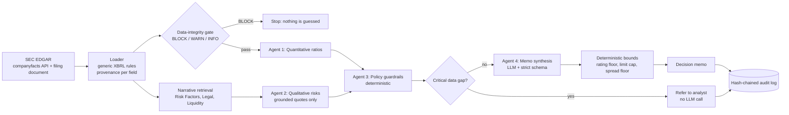

# Agentic Credit Underwriting & Decision Intelligence Engine

A prototype that reads a company's **latest SEC annual filing (10-K / 20-F)**, computes credit ratios, applies bank-style policy guardrails, reads the risk disclosures in the filing, and produces a **credit decision memo** with a rating, credit limit and pricing spread, every step recorded in a tamper-evident audit log.

> **Showcase project.** The numbers it uses for limits, spreads and thresholds are documented, justified calibrations, not a bank's approved credit policy. See [Limitations](#limitations-stated-honestly).

**Stack:** Python, Streamlit, LangGraph, Groq-hosted LLM (`openai/gpt-oss-120b` by default), Pydantic v2, lxml, SEC EDGAR APIs. **113 automated tests.**

---

## The one idea behind the design

> The LLM writes and reasons; **deterministic code decides what the bank is allowed to approve.**

Language models are good at reading disclosures and writing memos, and unreliable at arithmetic, thresholds and saying "I don't know". So the system is built so that the model **cannot** loosen a rule, invent a number, or quietly paper over missing data:

| Risk with a naive "LLM underwriter" | How this project handles it |
|---|---|
| Missing or wrong input numbers get silently defaulted | A **data-integrity gate** blocks the decision, or refers the case to an analyst, instead of guessing |
| LLM proposes a limit or price outside policy | **Deterministic decision rules** enforce a rating floor, a limit cap and a spread floor *after* the LLM answers |
| LLM output is malformed or out of range | **Strict Pydantic validation**, two attempts, then no automated decision |
| LLM invents risks | Every reported risk must **quote the filing word-for-word**; ungrounded findings are dropped and logged |
| "Who decided what, with which data?" | **Hash-chained audit log**: inputs, policy version, model, overrides, outcome; edits and deletions are detectable |
| Hard-coded fixes per company | **Generic extraction rules** over XBRL tags, with per-field provenance, instead of a list of company-specific tags |

---

## Architecture



**LangGraph state machine, four agents:**

1. **Quantitative** (`src/agents/quant_agent.py`): current ratio, debt-to-equity (financial-debt basis), TOL/TNW, interest coverage, DSCR, Altman Z″ (non-manufacturer variant). A ratio that cannot be computed is `None` with a reason, never `0`.
2. **Qualitative** (`src/agents/qual_agent.py` + `src/narrative.py`): retrieval-augmented. Pulls Risk Factors, Legal Proceedings and Liquidity from the filing, retrieves the passages most relevant to six credit topics, and asks the LLM for findings that **cite a passage and quote it verbatim**.
3. **Policy guardrails** (`src/agents/compliance_agent.py`): pure Python checks against the versioned policy in `src/policy.py`.
4. **Decision** (`src/agents/decision_agent.py` + `src/decision_rules.py`): LLM drafts the memo; the rules then clamp rating, limit and spread.

---

## What it can and cannot do today

**Handles**
- Live loading of the latest 10-K or 20-F for any non-financial SEC registrant (US-GAAP and IFRS), via the SEC `companyfacts` API with the filing document as fallback and cross-check
- Filing's own reporting currency (no FX conversion; limit is labelled in that currency)
- Analyst override with mandatory reason, recorded in the audit trail
- Candidate picker: when a field can't be resolved, the analyst can choose from the filing's own facts rather than typing a number

**Deliberately out of scope**
- **Banks, insurers and brokers** are detected (SEC industry code 6000-6411, plus a check on the filing's contents) and stopped with an explanation, because debt-to-equity, EBIT coverage and Altman Z″ do not measure credit risk for a balance sheet where debt is the product.

---

## Quick start

```bash
python -m venv venv && source venv/bin/activate      # Windows: venv\Scripts\activate
pip install -r requirements.txt
cp .env.example .env     # then set:
#   GROQ_API_KEY=...
#   SEC_IDENTITY="Your Name your@email.com"   (SEC fair-access policy requires a real contact)
#   GROQ_MODEL=openai/gpt-oss-120b            (optional; this is the default)
streamlit run app.py
python -m pytest -q                                   # 113 tests, no network or API key needed
```

Environment variables: `SEC_SOURCE` (`auto` | `companyfacts` | `ixbrl`), `AUDIT_LOG_DIR` (default `logs/`).

---

## Project structure

```
app.py                      Streamlit UI: load filing, review data, override, run, read memo, verify audit log
src/
  data_loader.py            SEC loader: CIK lookup, companyfacts + inline-XBRL parsing, generic mapping rules,
                            provenance, candidate suggestions, out-of-scope (bank) detection
  fields.py                 Single definition of every input field, units and which are required / soft
  validation.py             Data-integrity gate (BLOCK / WARN / INFO)
  policy.py                 Versioned policy: every threshold, with its justification
  narrative.py              Filing text -> sections -> chunks -> keyword retrieval by credit topic
  decision_rules.py         Post-LLM bounds: rating floor, limit cap, spread floor, referral
  audit_log.py              Hash-chained JSONL log + verify_chain
  graph.py                  LangGraph workflow and run entry point
  agents/                   quant, qual, compliance, decision agents
tests/                      113 tests: loader, gate, agents, decision rules, narrative, audit log
docs/                       Design decisions, case study, validation log, resume / portfolio notes
```

---

## Documentation

| Document | What it is |
|---|---|
| [`docs/DESIGN_DECISIONS.md`](docs/DESIGN_DECISIONS.md) | Every step: problem, decision, justification, trade-off, evidence |
| [`docs/VALIDATION_LOG.md`](docs/VALIDATION_LOG.md) | What was checked against real filings, and the bugs that checking found |
| [`docs/CASE_STUDY.md`](docs/CASE_STUDY.md) | Portfolio write-up of the project |
| [`docs/RESUME_AND_PORTFOLIO.md`](docs/RESUME_AND_PORTFOLIO.md) | Resume bullets, summary text, interview talking points, claims to avoid |

---

## Limitations (stated honestly)

- **Policy values are showcase calibrations.** Spread floors, limit caps and thresholds are justified in `src/policy.py` using public market references, but they are not a real bank's approved limits. Spread levels are indicative, not live-verified pricing.
- **Spread floors are USD-market calibrated**; for non-USD filers they apply over the local benchmark rate.
- **Qualitative review is retrieval + LLM**, not a full read of the filing. It sees about 16k characters of the most relevant passages. Findings are grounded, but absence of a finding is not proof of absence of risk.
- **Operating leases** are not counted as financial debt for US-GAAP filers (IFRS filers include all leases under IFRS 16). Noted, not normalised.
- **Verification so far is on a limited set of companies** (see the validation log). It is not a backtest against defaults and makes no claim of predictive accuracy.
- Not a lending product. No decision here should be relied on for real credit.
